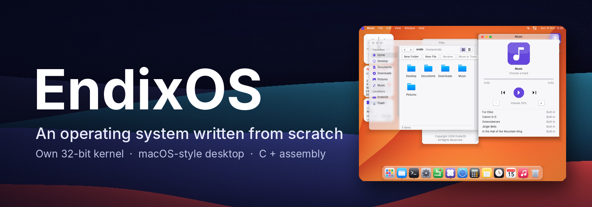
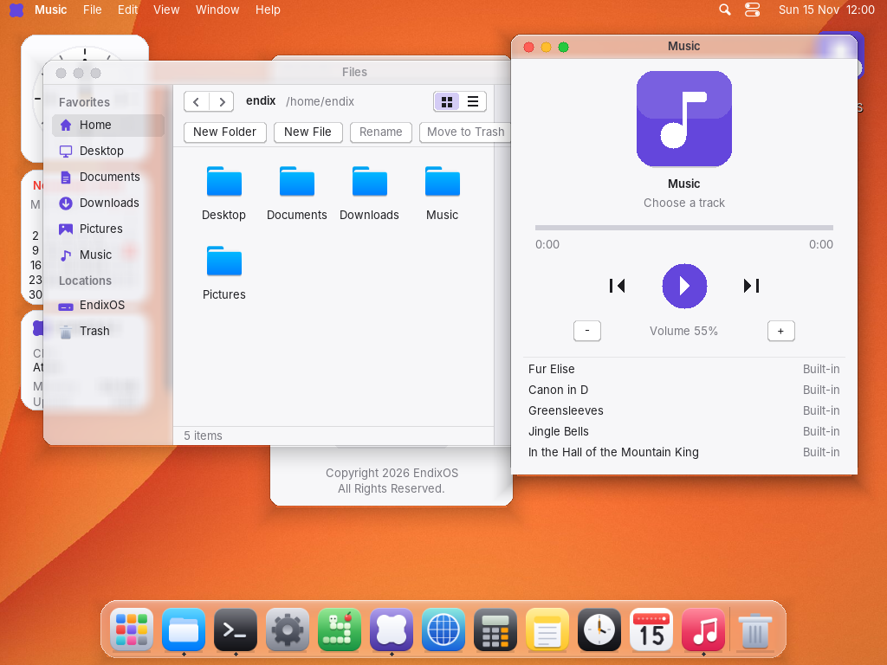
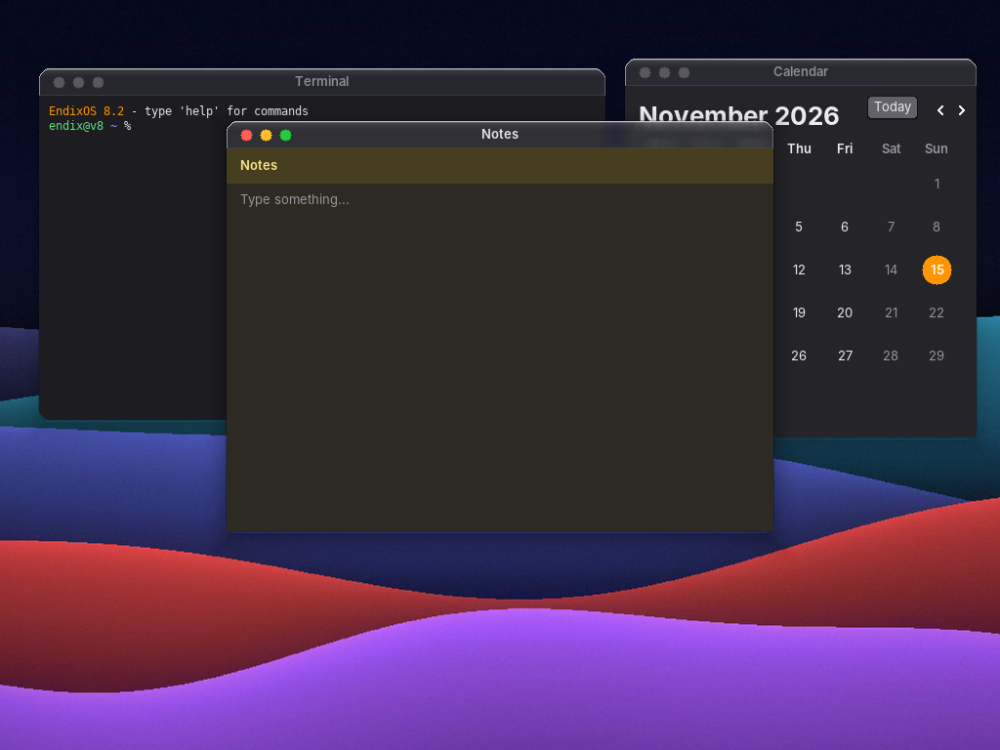
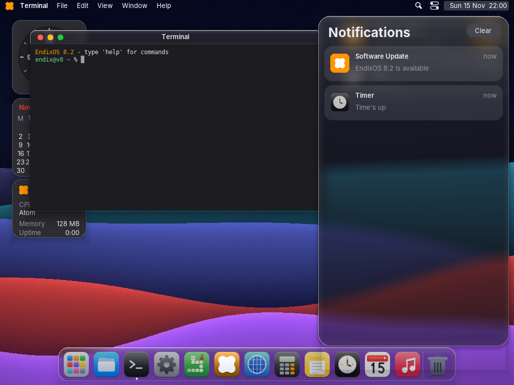
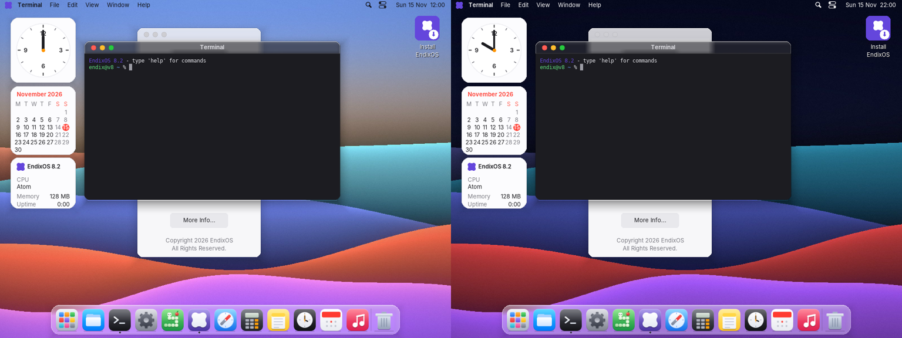
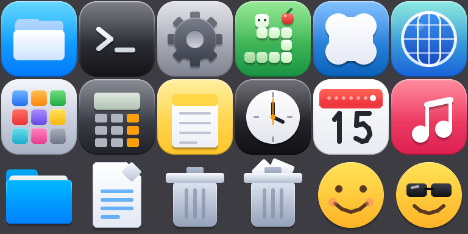

<p align="center">
  
</p>

<p align="center">
  
  
  
  
  
</p>

<p align="center">
  <b>A hobby operating system with its own kernel and a macOS-style desktop.<br>
  No Linux. No libc. No third-party libraries. About 31 000 lines of C and assembly.</b>
</p>

<p align="center">
  <a href="#-screenshots">Screenshots</a> ·
  <a href="#-features">Features</a> ·
  <a href="#-build-and-run">Build and run</a> ·
  <a href="#-status">Status</a> ·
  <a href="#-roadmap">Roadmap</a> ·
  <a href="#-по-русски">По-русски</a>
</p>

---

## 🖼 Screenshots

<table>
  <tr>
    <td width="50%"><br><sub><b>Desktop</b>: Dock, menu bar, widgets, Files, Music</sub></td>
    <td width="50%"><br><sub><b>Dark theme</b>: Terminal, Calendar, Notes</sub></td>
  </tr>
  <tr>
    <td width="50%"><br><sub><b>Notification Center</b>: click the clock</sub></td>
    <td width="50%"><br><sub><b>Dynamic wallpapers</b>: day and night, switched by the clock</sub></td>
  </tr>
</table>

<p align="center"><br><sub>12 built-in wallpapers, rendered ahead of time and embedded in the kernel</sub></p>

<p align="center"><br><sub>Every icon is drawn in code (signed-distance shapes), no image files</sub></p>

> Screenshots come from the host-side test harness (a 1024×768 framebuffer), not from a camera.

## ✨ Features

<table>
  <tr>
    <td width="33%" valign="top">

### 🧠 Kernel
- Multiboot boot via GRUB
- GDT / IDT / PIC, 100 Hz PIT, RTC
- PS/2 keyboard, mouse, Synaptics touchpad
- In-memory FS and on-disk **FAT32**
- Network stack with **TLS (HTTPS)**
- No libc: no 64-bit division, no floats

</td>
    <td width="33%" valign="top">

### 🔌 Drivers
- AHCI (SATA)
- Intel HD Audio
- JMicron JMC250/260 and e1000 Ethernet
- Realtek Wi-Fi (RTL8188CE)
- **USB 2.0 (EHCI)** mass storage
- Battery via the embedded controller

</td>
    <td width="33%" valign="top">

### 🖥 Desktop
- Animated windows, Dock, Mission Control
- Control Center, Spotlight, Launchpad
- Notification Center and widgets
- Light / dark themes, accent colors
- Liquid Glass look, icon styles
- Dynamic day/night wallpapers

</td>
  </tr>
  <tr>
    <td valign="top">

### 📦 Apps
- **Files**: copy, paste, rename, trash, context menu
- **Preview** and **TextEdit** windows
- **Terminal** with built-in commands
- **Browix**: a small web browser (HTTPS)
- Calculator, Notes, Snake

</td>
    <td valign="top">

### 🕐 Everyday tools
- Clock: stopwatch and timer
- Calendar with the real date
- Music player with built-in tunes and WAV files
- Settings for display, sound, Wi-Fi, trackpad, updates

</td>
    <td valign="top">

### 🛠 System
- Graphical **installer**: MBR, FAT32, GRUB
- Login screen with user accounts
- **Software Update** over the network, previous version stays in GRUB
- Performance mode for slow screens

</td>
  </tr>
</table>

## 🚀 Build and run

Arch / CachyOS:

```sh
sudo pacman -S --needed qemu-system-x86 nasm gcc make grub xorriso mtools
make run            # build the image and start it in QEMU
```

The mouse is captured on hover; release it with **Ctrl+Alt+G**. Building requires `gcc -m32` (or `i686-elf-gcc`).

### Bootable USB drive

```sh
lsblk                      # find your USB drive; a wrong name will erase another disk
make usb DEV=/dev/sdX      # builds the image and writes it to the drive (removable devices only)
```

Boot from USB in Legacy/CSM mode and pick a resolution in the GRUB menu. The system runs from RAM until you install it with the built-in installer.

## 🗂 Project layout

```
boot/      bootloader (Multiboot), interrupt stubs
kernel/    memory, FAT32, MBR, networking, TLS, crypto, installer
drivers/   PIT, PS/2, RTC, PCI, AHCI, HD Audio, Ethernet, Wi-Fi, USB, EC
gui/       graphics, fonts, window manager, apps, wallpapers
assets/    pre-rendered wallpapers (wall.pak)
tools/     font and wallpaper generators, host-side tests
docs/      development notes by stage (NOTES.md)
update/    the latest kernel and manifest for Software Update
```

All of it lives in [`endixos-v8/`](endixos-v8/).

## 🧪 Tests

Host-side tests (`endixos-v8/tools/tests/`) pull in the GUI and driver sources and check their logic: windows, Files, Settings, the installer, FAT32, a fake HD Audio controller and a fake **EHCI controller with a USB flash drive**. They do not replace testing on real hardware.

## 📋 Status

Target hardware: an old netbook (Intel Atom, 2 GB RAM, BIOS/Legacy, 1024×600). The system boots there and runs the desktop.

| Component | Verification |
|---|---|
| Desktop, windows, animations, apps | host tests, screenshots, **real netbook** |
| FAT32, installer, MBR | host tests, disk images |
| AHCI, HD Audio, Wi-Fi, touchpad, battery, USB storage | host models only, **not yet confirmed on hardware** |
| USB keyboards and mice, hubs, xHCI | not supported yet |

## 🗺 Roadmap

- [x] Own kernel, FAT32, installer, network and TLS
- [x] macOS-style desktop with Dock, Spotlight, Mission Control
- [x] Files, Clock, Calendar, Music, TextEdit, Preview, Browix
- [x] USB mass storage (first stage)
- [ ] USB flash drive in Files
- [ ] Russian keyboard layout and font
- [ ] Set date and time, sync over the network
- [ ] USB keyboard, mouse and hubs
- [ ] Working brightness keys

## 🇷🇺 По-русски

**EndixOS** это операционная система, написанная с нуля: своё 32-битное ядро на C и ассемблере и рабочий стол в духе macOS. Без Linux и без чужих библиотек. Целевое железо: старый нетбук (Atom, 2 ГБ ОЗУ). Запуск: `make run` (QEMU) или `make usb DEV=/dev/sdX` для загрузочной флешки. Обновления ставятся из Настроек → Software Update, файлы лежат в [`endixos-v8/update/`](endixos-v8/update/).

## 📄 License

Released under the [MIT License](LICENSE). Fonts: Inter (SIL Open Font License), DejaVu Sans Mono (Bitstream Vera / DejaVu license).
