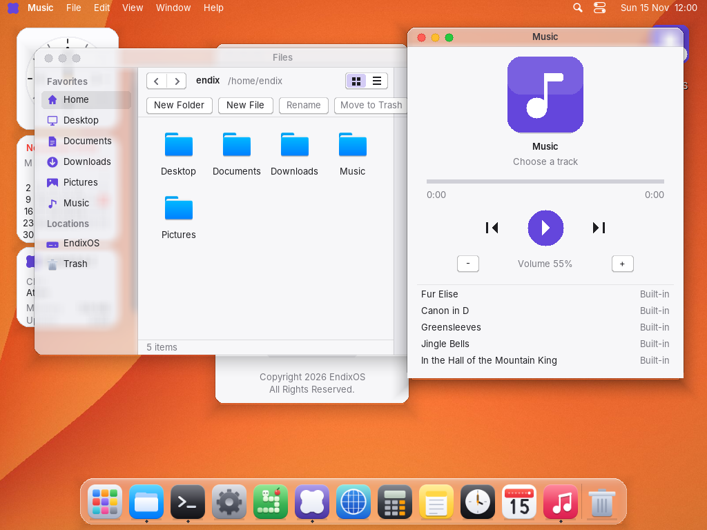
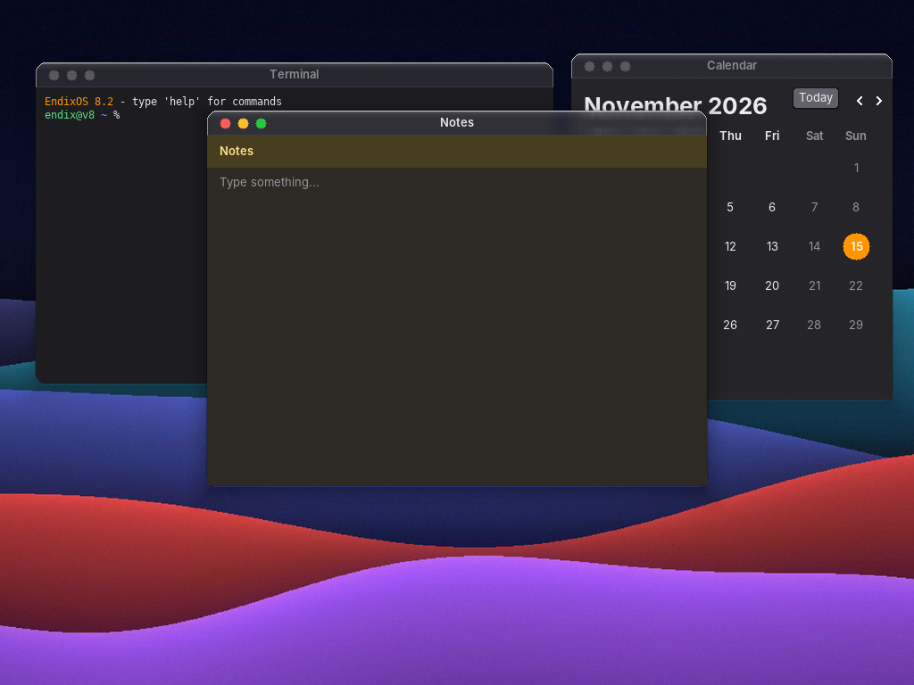
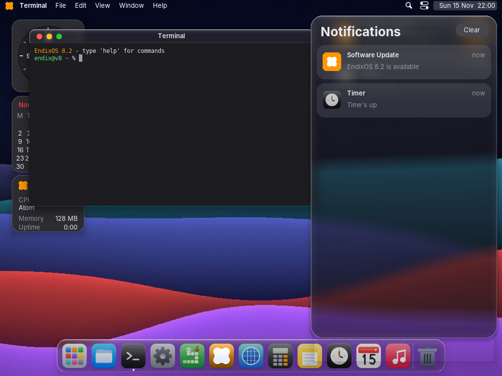
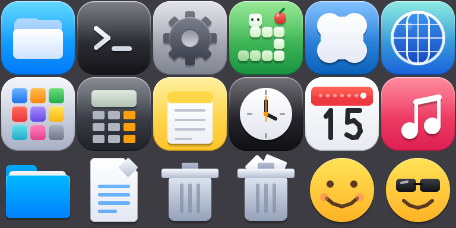
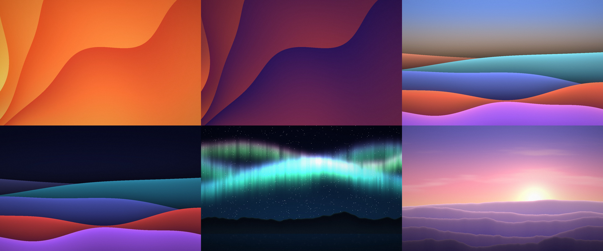
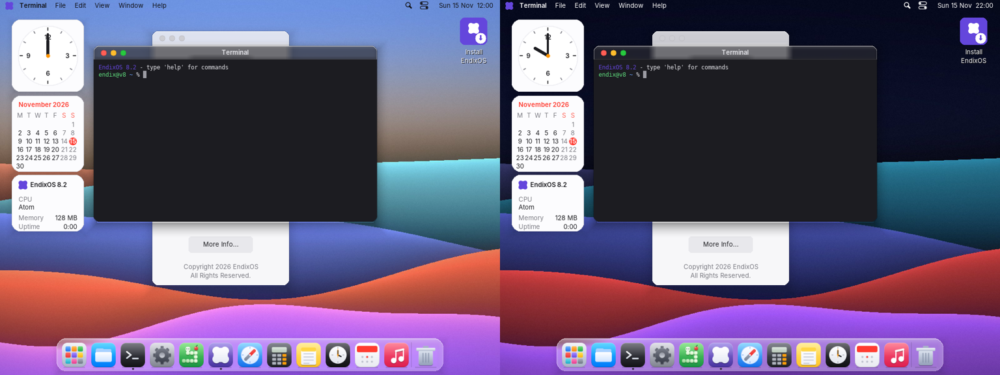

# EndixOS 8.2

Операционная система, написанная с нуля: собственное 32-битное x86-ядро на C и ассемблере и графический рабочий стол в духе macOS (Liquid Glass). Без Linux, без libc, без чужих библиотек.

> Проект учебный и экспериментальный. Целевое железо: старый нетбук (Atom, 2 ГБ ОЗУ, BIOS/Legacy). Многое проверено только в тестах на хосте и в эмуляторе, см. [Статус](#статус).

## Скриншоты








*Снимки сделаны в тестовом окружении на хосте (эмуляция экрана 1024x768). Работа на реальном нетбуке подтверждена частично.*

## Возможности

**Система**
- Multiboot-загрузка через GRUB, GDT/IDT/PIC, таймер PIT 100 Гц, RTC
- PS/2 клавиатура и мышь, очередь событий
- Файловая система в памяти и FAT32 на диске (чтение/запись, длинные имена при чтении)
- Графический установщик на диск: разметка MBR, FAT32, загрузчик GRUB, экран входа с пользователями
- Корзина, поиск (Spotlight), уведомления

**Железо**
- AHCI (SATA), USB 2.0 EHCI (флешки, этап 1, не проверено на железе), Synaptics-тачпад, батарея через EC, Intel HD Audio (звук), JMicron JMC250/260 и e1000 (сеть)
- Сетевой стек со встроенным TLS (HTTPS) и простым браузером

**Рабочий стол**
- Окна с анимациями, Dock с контекстным меню, строка меню, Mission Control, Control Center
- Files (иконки и список, просмотр картинок, редактирование текста), Settings, Terminal, браузер Browix, Snake
- Календарь, Часы (секундомер и таймер), Музыка, Заметки, Калькулятор, Центр уведомлений, виджеты
- Прозрачная панель в стиле macOS Tahoe, темы (светлая/тёмная), акцентные цвета
- 12 встроенных обоев (заранее отрендерены, лежат внутри ядра), в том числе «живые» пары день/ночь в духе macOS и свои фото из `/Pictures` (JPEG)
- Выбор разрешения экрана на следующий запуск (Settings → Displays)
- Software Update в Настройках: обновление по сети с GitHub, старая версия остаётся пунктом в GRUB
- Авто-режим скорости: на слабом экране сам отключает тени и размытие (Settings → Displays → Performance)

## Сборка и запуск

Arch / CachyOS:

```sh
sudo pacman -S --needed qemu-system-x86 nasm gcc make grub xorriso mtools
make run            # собрать образ и запустить в QEMU
```

Мышь захватывается при наведении; освободить: **Ctrl+Alt+G**. Для сборки нужен `gcc -m32` (или `i686-elf-gcc`).

### Загрузочная флешка

```sh
./tools/mkusb.sh             # выбрать съёмный диск и записать с нуля (всё на нём сотрётся!)
./tools/mkusb.sh --refresh   # потом: заменить только ядро на готовой флешке (пара секунд)
```

То же делают `make usb` и `make usb-refresh`. Скрипт трогает только съёмные диски, просит ввести имя устройства, собирает ядро, размечает флешку (MBR, активный FAT32), ставит GRUB для BIOS и сверяет скопированное ядро. Нужны `parted dosfstools grub util-linux`.

Загрузись с USB в режиме Legacy/CSM (F12/Esc). В меню GRUB выбери разрешение под экран. Система работает из ОЗУ, пока не установлена на диск через встроенный установщик; дальше обновляется из Settings → Software Update.

## Структура

```
boot/      загрузчик (Multiboot), обработчики прерываний
kernel/    ядро: память, FAT32, MBR, сеть, TLS, криптография, установка
drivers/   PIT, PS/2, RTC, PCI, AHCI, HD Audio, e1000, JMicron
gui/       графика, шрифты, окна, приложения, обои, установщик
assets/    готовые 3D-обои (wall.pak)
tools/     генератор шрифта, рендер обоев, тесты на хосте
docs/      заметки по этапам разработки (NOTES.md)
```

## Тесты

Тесты на хосте (`tools/tests/`) подключают исходники GUI и драйверов и проверяют их логику: окна, Files, Settings, установщик, FAT32, звуковой драйвер на модели контроллера и т. д. Это не замена проверке на реальном железе.

## Статус

| Часть | Проверка |
|---|---|
| GUI, окна, анимации, Files, Settings | тесты на хосте, скриншоты |
| FAT32, установщик, MBR | тесты на хосте, образы дисков |
| AHCI, HD Audio, JMicron, фото-обои, запись `grub.cfg` | **не проверено на реальном железе** |
| Wi-Fi, USB-накопители, eMMC/SD | пока не поддержаны |

## Лицензии

Шрифты: Inter (SIL Open Font License), DejaVu Sans Mono (Bitstream Vera / DejaVu license). Лицензия самого проекта пока не выбрана.
